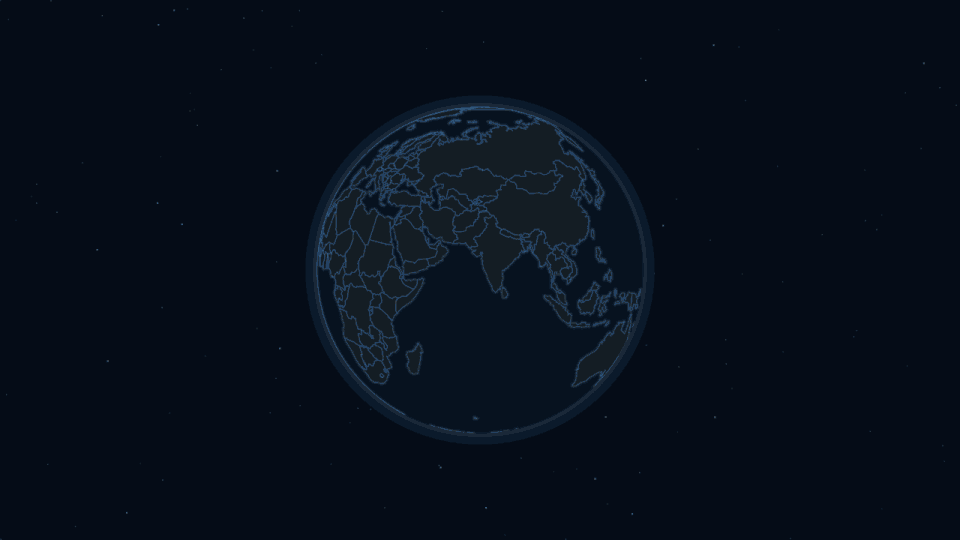

<p align="center"></p>

# 🗺️ LazyMapLayers — Free Map Animation for After Effects

<p align="center">
  
  
  
  
  
</p>

<p align="center"><strong>🎬 New to LazyMapLayers? Start with the video tutorials:</strong> <a href="https://youtu.be/FkpwM74xt-s">the complete tutorial</a> shows every tool, and <a href="https://www.youtube.com/playlist?list=PLdM39o5SFdHk">the tutorial playlist</a> has the lessons one by one.</p>

<p align="center">
  <a href="https://youtu.be/FkpwM74xt-s"></a>
  <a href="https://www.youtube.com/playlist?list=PLdM39o5SFdHk"></a>
</p>

<p align="center"><a href="https://youtu.be/FkpwM74xt-s"></a></p>

<p align="center"><a href="https://raisulsohan.com/en/portfolio/lazymaplayers/"></a></p>

<p align="center"><strong>See a whole job:</strong> <a href="https://raisulsohan.com/en/portfolio/lazymaplayers/">the 32-second demo</a> makes one map shot in After Effects with no internet, from <em>New map</em> to the final render, and plays it. The player page is also in <a href="docs/demo/lazymaplayers-in-ae.html">docs/demo</a>: download it and open it in a browser.</p>

<p align="center"><strong>📖 <a href="docs/manual/README.md">The manual</a>:</strong> every option, one chapter at a time, with pictures and animations from After Effects. Also on <a href="https://raisulsohan.com/en/portfolio/lazymaplayers/documentation/manual/">raisulsohan.com</a>.</p>

<p align="center">
  <strong>Maps, flights, routes and data stories for motion designers, rendered frame-exact inside After Effects. Free forever: no account, no key, no trial.</strong>
</p>

Developed by **[Raisul Sohan](https://raisulsohan.com)** · Part of the Lazy suite · Free & open source ([MIT](LICENSE))

> **Version 1.2.0** — street detail anywhere: fly into any city and the panel fetches only the streets its frames need, keeps them, and names offline the frames that lack them; the installer asks Full (2 GB, everything offline), Light (about 120 MB) or Online, and a light download of about 150 MB sits beside the full one; routes that follow the real roads by car, bicycle or on foot, found by LazyMapLayers' own router with no service or key; an arrow rig with a taper and a head that stays on the tip, every look a control on the layer; imagery from WMS services, tile folders and MBTiles files, and seven more open aerial services; and a Self-test whose report goes into a problem report in one step. In 1.1.2: in the historical borders, the largest empires never share a colour and keep theirs from year to year. In 1.1.1: Vietnam and Yemen divided in 1960 and 1971. In 1.1.0: the world in any year: pick one of 56 moments from 123,000 BC to 2010 and the map shows that year's countries, empires and colonies, each colony in its ruling power's colour; key the History Year slider and the map moves through history, fading only what changed hands; highlight, search, name and browse the states of the past (1947 and 1971 made for LazyMapLayers). In 1.0.2: a route across the Pacific stays one arc on the flat map, and a table of numbers by year opens as numbers again. In 1.0.1: Alt+Shift+click drops a 3D pin again. In 1.0: works offline down to city level: the download carries OpenStreetMap for the whole world to zoom 9, elevation, satellite and relief pictures and the districts of every country, so a flight from the globe into any country lands on real detail with no internet connection; borders read at every zoom, and the panel scrolls in a short window. In 0.9: prism maps that raise every place by its number in 3D; a route or an area drawn straight over the map with After Effects' Pen tool; street and river names bent along their line; one map's camera following another's for split screens and overviews; and oceans kept named on a turning globe. In 0.8: the map names the natural world (seas, rivers, mountains, peaks) and, over a downloaded area, what is inside a city (districts, landmarks, the river and the main streets laid along them); colours by category; moves through the years with a line or area chart that follows it; puts a flag per country into your own label design; searches streets and addresses on OpenStreetMap; and a duplicated scene gets a map of its own. In 0.7.1: cities and roads on the world map. In 0.7: a real satellite picture of any area, built free from Sentinel-2, and a camera imported from Google Earth Studio. Before that, in 0.6: a feature browser with a written filter, live numbers watched on disk, a bar chart, a scale bar, a north arrow, an inset locator map, labels you design yourself, and a scripting API. Also: imagery of your own and ten open aerial services; numbers on the map as colours, bubbles, spikes, heat, flows and copies of your own layer; twelve looks and their details; what is under the pointer; looks of your own (or taken from a still of your film), any OpenStreetMap feature, editable shape layers and label templates. Features on the roadmap are still to come; see [docs/PLAN.md](docs/PLAN.md) for the plan and [docs/SPIKES.md](docs/SPIKES.md) for what has been measured inside After Effects and [docs/PERFORMANCE.md](docs/PERFORMANCE.md) for the budgets it must keep. [docs/GUIDE.md](docs/GUIDE.md) walks through every sheet and tool, and [the manual](docs/manual/README.md) gives every option a chapter of its own, with pictures and animations from After Effects.

**Privacy.** The panel never sends anything about you or your project. It goes online when you ask
for a download, an OpenStreetMap search or a route on roads; when a map comes closer than the data on
your computer reaches, to fetch the street detail its frames need from the Protomaps planet build
(byte ranges of one public file, nothing else sent; Maps > About > *Street detail from the internet*
turns it off); and once a day to look at the release list on GitHub for a newer version (one request,
nothing sent; the switch is next to it). With imagery of your own switched on, tiles are fetched from
the address you gave while you preview and render. **Report a problem** opens the issue form in your
browser with your versions and the Self-test's verdict filled in; nothing is filed until you submit it.

## Install

Requirements: After Effects 2024 or newer, on Windows 10/11 or macOS (experimental). Tested on
Windows 11 with After Effects 2026; it has not been run on a Mac yet, so on macOS please report what
you find.

**Three ways to install.** The installer asks how much map data to keep on your computer:

| Choice | Disk space | What works without the internet |
|---|---|---|
| **Full** | about 2.1 GB | Everything from the globe down to a city: OpenStreetMap for the whole world to zoom 9, elevation for the whole world, satellite and shaded relief pictures, and the districts of every country |
| **Light** | about 175 MB | The world to zoom 6 (country level) and coarse elevation |
| **Online** | about 50 MB | The world map from Natural Earth (countries, provinces, cities, rivers), which is part of the panel |

Whichever you pick, maps look the same: with Light and Online, closer detail comes from the internet
as your maps need it and is kept, so it works offline afterwards. Street detail, finer elevation,
Sentinel-2 pictures and street search go online when a map or you ask for them; with Light or Online,
so do the satellite and relief pictures and the districts. Leave room for that and for your renders.

1. Download from the [Releases](https://github.com/raisulsohan/LazyMapLayers/releases) page and unzip:
   `LazyMapLayers-v1.2.zip` (about 2.1 GB, offers all three) or `LazyMapLayers-v1.2-light.zip`
   (about 150 MB, offers Light and Online).
2. Close After Effects.
3. Windows: double-click **Install LazyMapLayers.bat**. macOS: double-click
   **Install LazyMapLayers (macOS).command** (if macOS refuses, right-click it and choose Open).
   Type 1, 2 or 3 for Full, Light or Online.
4. Start After Effects and open **Window > Extensions > LazyMapLayers**.

The package is signed, so no extension manager or debug setting is needed. If the panel opens blank,
run **Fix a blank panel.bat** (Windows) and restart After Effects.

**First map in a minute:** click **World flight sample**, then **Render**. Online, the flights go down
to the streets of Paris and Tokyo by themselves. To keep them for working offline, move the preview
over Paris or Tokyo, click **Download this area…**, name the region `paris` or `tokyo`, and build the
sample again.

**Help and reports.** Questions go to [Discussions](https://github.com/raisulsohan/LazyMapLayers/discussions),
answers to common ones are in the [FAQ](docs/FAQ.md). To report a problem in one step: **Maps > About >
Report a problem** runs the Self-test, puts the report on your clipboard and opens the issue form;
paste and submit. **Mac testers wanted:** LazyMapLayers is tested on Windows; if you have a Mac with
After Effects 2024 or newer, install it, press *Report a problem* and tell us how it went, even when
everything works.

## A flight, offline



---

## Why another map tool?

Paid map plugins for After Effects work, but they are expensive, depend on paid data partners, and
still show their seams: blurry zoom steps, labels that pop, moves that stop halfway. LazyMapLayers is
built to be free **and** to give better final frames.

For a row-by-row comparison with GEOlayers 3, including where it is still ahead, see
[docs/COMPARISON.md](docs/COMPARISON.md).

| | LazyMapLayers |
|---|---|
| Basemap | Every frame is rendered at its exact camera, so there are no tile steps, zoom cross-fades or shrinking labels. |
| Camera | One continuous zoom-and-pan curve (van Wijk–Nuij), globe to street level, pitch up to 85°, 3D terrain and buildings. |
| Compositing | Separate render passes: land, water, roads, boundaries, buildings, plus mattes. |
| AE layers | Pins, labels, routes and borders are real AE layers that line up with the rendered map to sub-pixel accuracy. |
| Labels | Placed over the whole timeline with collision checks and smooth fades. Arabic, Hindi, Bengali, Thai, CJK and every other script shape correctly. |
| Data | Offline Natural Earth world data, OpenStreetMap detail for any city (fetched as maps need it, or downloaded to keep), open terrain and imagery. |
| Undo | Every panel action is one Ctrl+Z. |

## Your first flight, click by click

Dhaka to Chittagong with an arrow, say:

1. Open a comp. **Maps list** (top left) > **New map** > **Create**.
2. Search `Dhaka`, click it, scroll to the zoom you want. **Shots** tab > **+ Shot**.
3. Search `Chittagong`, click it, set the zoom, **+ Shot**.
4. Click the move between the shots: **Along route**, 6 s, a flight height, easing **Cinematic**.
   **Play** shows it in the preview; **Apply to timeline** writes the keys in one undo step.
5. **Route** tool: click Dhaka on the map, then Chittagong; switch **Arrow** on; **Add route**.
   The line draws on from the current time and the arrow rides it (parent your own plane to the
   Traveller layer if you want one). **Follow: Car** puts the route on the roads instead of an arc,
   and **Arrow rig** draws it as one tapered arrow with its head on the tip.
6. **Auto labels** > **Place labels**. **Preview** to check, **Render** for the final frames.

## What works today (1.2)

- **Street detail anywhere.** Fly into any city on the World basemap and its streets, buildings and
  names are there with nothing downloaded first: the panel works out which OpenStreetMap tiles the
  frames need (a fly-to into a city is a few megabytes), fetches only those from the Protomaps planet
  build, keeps them, and draws them as a downloaded region would. The preview fetches as you move it.
  Offline, a render draws what the computer holds and names the frames that lack their detail;
  online again, only those frames are drawn again. Maps > About > **Street detail from the internet**
  turns it off.
- **Full, Light or Online.** The installer asks how much map data to keep: **Full** (about 2 GB, the
  world down to city level without the internet), **Light** (about 120 MB, the world to zoom 6 and
  coarse elevation) or **Online** (nothing more). Maps look the same whichever you pick, and a light
  download of about 150 MB sits beside the full one.
- **Routes on roads.** The Route sheet's **Follow: Arc, Car, Bicycle, On foot**. A car keeps to
  one-way streets and off closed roads, a bicycle off motorways, a walker takes footpaths, steps and
  bridges: Dhaka to Chittagong by car runs 98 % on N1, and a walk from the Eiffel Tower to the Louvre
  keeps to the pavements and crosses the Seine on a bridge. LazyMapLayers finds the way itself over
  OpenStreetMap's roads, with no routing service, account or key, and keeps the roads on disk, so the
  route comes again offline. The result is an ordinary route: Arrow, Comet, Dashed, the arrow rig and
  a camera move along it all work, and the log gives its length, time and main roads.
- **Arrow rig.** A route or an imported line drawn as one arrow layer: the line tapers from its tail
  to a head that always sits on its tip under any camera (triangle, chevron or none, at one end or
  both) and stops just behind the point, with dashes that flow and an outline. Progress, Tail, the
  widths, the taper, the head and the colours are controls on the layer, to key in After Effects.
- **Imagery of your own, from anywhere.** Any XYZ, WMTS or WMS address or PMTiles archive on the web,
  a folder of `{z}/{x}/{y}` tiles (gdal2tiles, QGIS, drone software) or an MBTiles file on your
  computer, drawn over the ground and under the lines in the preview and the render, at the opacity
  you set, with the credit on the credit line. For a WMS address the panel lists the service's layers
  and formats and fills in its credit; for a folder or an MBTiles file it works out the zooms, the
  area and the tile size, with no internet. Seventeen open government services are listed with their
  licences, one pick away: USGS, PDOK, swisstopo, IGN, GSI, PNOA, basemap.at, ČÚZK, ACT Luxembourg,
  Maa-amet, Flanders, and North Rhine-Westphalia, Bavaria, Brandenburg, Berlin, Lower Saxony and
  Thuringia.
- **Self-test, and a report in one step.** Maps > About > **Self-test** checks LazyMapLayers in your
  own After Effects in a few seconds: the host script, one rendered frame, a map comp made and removed
  again in one undo step, a pin and a 3D pin against the camera maths, and the map data on the
  computer. **Report a problem** runs it, puts the report on the clipboard and opens the issue form
  with your versions filled in: paste and submit.

- **The world in any year.** Historical borders (a 13.9 MB download from the Look sheet) give 56
  moments from 123,000 BC to 2010: every state, empire and colony of that year, each colony in its
  ruling power's colour, neighbours never in one colour, the borders between them and their names, in
  place of today's countries. 1947 (the partition of British India) and 1971 (Bangladesh) were made for
  LazyMapLayers, and British India in 1945 and Ceylon before 1948 corrected. The **History Year**
  slider on the map layer moves the map through history over the comp, fading only what changed hands,
  with a year counter on screen. Click a state of the past to highlight it (Shift+click: every land of
  its empire), find it in the search, let Auto labels name the map by that year, and browse them all
  in the feature browser. Step by step, with pictures: [Historical borders](docs/manual/historical-borders.md)
  in the manual.

- **Offline, down to city level.** With the Full install the map data is on your computer:
  OpenStreetMap for the whole world to zoom 9 (coasts, rivers, lakes, roads, parks, the borders of
  every country) under every map, elevation for the whole world, the satellite and relief pictures,
  and the districts of every country. Street detail your maps fetched, and areas you download, stay
  for working offline too.

- **Prism maps.** Colour the map by a column of numbers and raise it: every place stands as high as
  its number, so a tilted camera reads the amounts at a glance. The renderer draws the prisms, on
  the flat map and on the globe, and over the years they grow with the map.
- **Draw a route with the Pen tool.** Draw over the map in After Effects - a shape layer or masks -
  and turn it into routes and areas that follow the map, curves and all.
- **Names that bend.** Street, quay and river names inside a city follow the curve of their line
  and still turn and tilt with the camera.
- **Maps that follow each other.** A second map in the same comp can take the first one's camera,
  for split screens or an overview in the corner some zoom steps out.
- **A look of your own.** Set the sea, the land, the lines and the names, and the rest of the map -
  roads, borders, buildings, parks, coasts, sky - is worked out from them, with the names kept
  readable on whatever land you chose. **From a picture** takes the palette of a still from your
  film; a look can be saved to a file, shared, and opened again, and Illustrator or Photoshop
  palettes (.ase, .act) open straight into one.
- **Numbers on the map.** A CSV with a country column (or one country's states, provinces or downloaded districts) and a
  column of numbers colours every place it names as one layer, adds circles whose area is the value
  or spikes whose height is, draws flows between places as arcs whose width (and colour) is the amount,
  renders the places' warmth as a heat layer, gives every place its own shape layer filled and
  stroked by its number, copies a layer of your own onto every place sized by its number,
  writes the numbers as text layers, and builds a legend and a bar chart as precomps. Places are found by name in 26
  languages, by ISO code, by a state's short code or by the map's own code; rows that match nothing
  are listed rather than coloured on a guess.
- **A real satellite picture of any area, free.** The panel builds a ten metre a pixel basemap from
  the European Union's Sentinel-2 imagery, taking each pixel from the clearest pass and leaving
  cloud to the next one. No account, no key: the catalogue and the scenes are open, and only the
  pieces your area needs are downloaded.
- **A camera from Google Earth Studio.** Export the camera of your own Earth Studio render as
  JSON, open it in the panel, and the map's camera is keyed to theirs frame by frame, so names,
  pins and routes sit on your footage. Track points arrive as pins.
- **Live numbers.** Watch a CSV on disk: edit it anywhere and the table is read again and the map
  coloured again, with no import.
- **Driven by your own scripts.** Turn it on and any program on the computer can make maps, move
  the camera, add layers and render, by leaving a small file for the panel to answer.
- **A feature browser.** Every country, province, district or imported shape in one list: search
  it, sort it by any property, filter it in words (`population > 200000000`), then highlight what
  is left, add it as shape layers, merge it, break it apart, cut one shape out of another, count
  the points inside each, or join them all with connection lines.
- **An inset map that is a real map.** A locator in the corner, as many zooms wider as you ask,
  with a box on it that moves and turns with the big map on every frame. The inset takes its own
  look, its own names and its own render, because it is another map in the same scene.
- **A scale bar and a north arrow that stay honest.** Both read the map through expressions, so the
  bar re-measures itself on every frame and always shows a round distance through a zoom, in metric
  or imperial, and the arrow turns with the bearing and follows the pole on the globe. Plain layers:
  move them, recolour them, keyframe them.
- **Any OpenStreetMap feature.** Type a name (or pick water, parks, islands, airports, boundaries,
  buildings, roads or railways) and the panel finds what OpenStreetMap holds for the area in the
  preview: a lake with its islands as real holes, a river, a district outline. It arrives as an
  import, so everything you do with a GeoJSON file works with it.
- **Labels you design yourself.** Make a comp - a box, an icon, a population line - with text layers
  like `{name}` and `Pop. {populationShort}`, and every place gets a copy of it with its fields
  filled in, placed over the whole timeline without overlaps.
- **Label templates and keep-out zones.** One row sets the colour, size, halo, capitals and dots of
  every name, or takes them from a text layer you styled yourself, and the names already on the map
  follow at once - restyled and placed again, so bigger names never overlap; names can be kept out of the lower
  third, a top bar, or whatever your own layers cover while they are on screen.
- **Areas of your own.** Merge the highlights into one shape with the borders between them gone, grow
  or shrink them by a distance in kilometres, or drop a distance circle.
- **Twelve looks, and their details.** Noir, Slate, Terracotta, Arctic and Emerald join the seven, and
  three knobs under the colours turn the lines and roads heavier or lighter and draw fewer or more
  names, in every look, in the preview and the render alike.
- **What is here.** A readout under the pointer: the coordinates, the nearest place, its district and
  province, and the country, offline. Pins and routes are named after their places.

### From 0.2, and the work since

- **Shot list.** Build the camera from shots: **+ Shot** takes the view in the preview; between
  shots a Fly, Straight, Along route or Cut move with a duration, flight height and easing; **Play**
  runs it in the preview; **Apply to timeline** writes the keys in one undo step. The preview is the
  exact frame.
- **Looks.** Midnight, Satellite (NASA Blue Marble), Daylight, Atlas, Blueprint, Mono and Paper, with
  optional shaded relief; one palette colours the map, regions, the globe's haze, borders and labels.
- **3D terrain.** Download an elevation pack for an area (open data through Mapterhorn), then shaded
  slopes and real 3D mountains with the sky above the horizon; pins, labels and routes sit on the
  ground, and a keyed Terrain Height slider makes the mountains rise.
- **Highlights.** Countries, provinces (4,589 built in), districts (downloaded per country from
  geoBoundaries) and shapes from your own files, each rendered as its own layer above the basemap.
- **Export.** Save what is on the map back out as GeoJSON: pins, routes, outlines, callouts and
  highlighted areas.
- **Your own layers on the map.** Select your artwork in After Effects, click a place, and it stays
  there while the camera moves; Unlink puts it back as it was.
- **Shape layers.** Any highlighted country, province, district or imported area can be added to the
  comp as an editable After Effects shape layer: real paths that follow the map, with a fill, a
  stroke and an optional draw-on.
- **Search.** Countries, provinces, districts and cities in 26 languages, or coordinates, offline.
- **Import.** GPX, KML, KMZ, GeoJSON, CSV and shapefiles: routes that draw on (at the recorded pace
  of a GPS track if you like), a traveller that rides the line, pins for places, areas to highlight,
  and camera moves along a line.
- **Auto labels in batches.** Names arrive a few at a time with progress and cancel; three densities.

### From 0.1

- **Globe to street level.** A Globe checkbox per map: a turning planet with an atmosphere at low
  zoom that becomes the flat map by zoom 8, and **Fly here** keys one continuous flight to the
  preview view.
- **Auto labels.** Country and city names in the local language and script, with English subtitles,
  as editable After Effects text layers placed over the whole timeline without overlaps or flicker.
- **Animated borders, routes and callouts.** Borders draw on frame-exactly in the renders;
  great-circle routes arc above the globe and draw on; callouts with a leader line, title and
  subtitle.
- **Layered regions.** Several downloaded regions work together: a wide region hands over to the
  detailed city inside it, over the offline world map.

- **Offline world basemap.** Built from Natural Earth: countries (names in 26 languages), coastlines,
  boundaries, lakes, rivers and cities.
- **Frame renderer inside After Effects.** MapLibre GL JS renders 1080p frames in about 75–170 ms and
  4K frames in about 280–640 ms, including PNG encoding.
- **Region downloads.** Any area of the OpenStreetMap planet (Protomaps builds) is fetched with HTTP
  range requests into a local file, then rendered offline with 3D buildings.
- **Camera maths.** Our camera equals MapLibre's projection to within 0.00000003 px.
- **Map comp creation from the panel.** Tagged comps, camera controls and view keyframes, all
  undoable.
- **Render queue.** The panel renders the basemap for every frame of the map comp at its exact
  camera and imports it as an image sequence. Only frames that changed are drawn again, renders can
  be cancelled and resumed, and previews become After Effects proxies.
- **Final quality.** Up to 4× supersampling, motion blur that matches After Effects' shutter, and a
  10-second 4K move in about 30 seconds on a mid-range GPU.
- **Passes and mattes.** Land, water, boundaries, roads and 3D buildings as separate footage, plus
  land and water mattes, for grading and effects in After Effects.
- **Pins.** 2D pins follow the animated camera. In After Effects' own render they sit on the exact
  pixel the renderer draws (worst error 0.006 px at 1080p and 4K).
- **Matched 3D camera.** One click adds an After Effects camera that matches the map, so 3D layers
  and 3D pins sit on the ground as the camera moves (worst error 0.004 px).
- **Region download safety.** Tile estimates for each detail level, and warnings for large
  downloads and existing names.

## Development

Requirements: Windows or macOS, Node.js 24+, After Effects 2024 or newer with
`PlayerDebugMode = 1` for unsigned extensions.

```
npm install
node tools/fetch-natural-earth.mjs      # the Natural Earth zips into .cache/ne (about 69 MB from naciscdn.org)
node tools/prepare-natural-earth.ts     # needs the Natural Earth zips in .cache/ne (see the script header)
node tools/prepare-world-overlays.ts    # borders and names for draw-on borders, labels and search
node tools/prepare-admin1.ts            # provinces for search and highlights (ne_10m_admin_1_states_provinces.zip)
npm run verify                          # unit tests, typecheck, build, ExtendScript checks
npm run install:dev                     # link dist/ into the CEP extensions folder
npm run ae:spikes                       # optional: run the in-AE test suite (starts After Effects)
node tools/extract-region.ts --name paris --bbox 2.2,48.8,2.48,48.92 --max-zoom 15
node tools/package-zxp.mjs              # release: build, sign and zip (see docs/RELEASING.md)
```

Project layout:

```
CSXS/          extension manifest
panel/         panel HTML and CSS
src/core/      pure TypeScript: projection, camera, fly paths, tiles, PMTiles, PNG
src/panel/     panel UI, CEP bridge, MapLibre renderer
src/host/      ExtendScript (ES3), concatenated into dist/host/lazymaplayers.jsx
tools/         build, data preparation, region download, AE test automation
tests/         unit tests (node --test)
docs/          plan, decisions, spike results, changelog, release steps
```

## Data and credits

- **[Natural Earth](https://www.naturalearthdata.com)** (public domain). "Made with Natural Earth."
- **[OpenStreetMap](https://www.openstreetmap.org/copyright)** data (ODbL), through the
  [Protomaps](https://protomaps.com) basemap builds: the whole world to zoom 9 comes with the Full
  install (to zoom 6 with Light), street detail is fetched as maps need it, and areas are downloaded
  when you ask; OpenStreetMap features and the roads of routes on roads come through the
  [Overpass API](https://overpass-api.de). Maps that show OSM data must credit
  "© OpenStreetMap contributors"; the panel adds that credit to a render that shows it.
- **[NASA Blue Marble Next Generation](https://visibleearth.nasa.gov/collection/1484/blue-marble)**
  (public domain; NASA Earth Observatory) for the satellite imagery pack, and Natural Earth's shaded
  relief for the relief pack. Both come with the Full install and are also published as assets of the
  [Imagery packs release](https://github.com/raisulsohan/LazyMapLayers/releases/tag/imagery-1).
- **[geoBoundaries](https://www.geoboundaries.org)** (open release; each country's boundaries under
  their own open licence, kept with each country's set) for the district boundaries of every country,
  which come with the Full install. Runfola, D. et al. (2020), geoBoundaries: A global
  database of political administrative boundaries, PLoS ONE 15(4).
- **[historical-basemaps](https://github.com/aourednik/historical-basemaps)** by A. Ourednik and
  contributors (GNU GPL 3.0) for the historical borders, a separate download published as the
  [Historical borders release](https://github.com/raisulsohan/LazyMapLayers/releases/tag/history-3)
  with LazyMapLayers' corrections (`data/history/corrections.json`). The panel adds "Historical
  borders: historical-basemaps (GPL-3.0)" to a render that shows them.
- **[Mapterhorn](https://mapterhorn.com)** (open elevation tiles built from the Copernicus 30 m
  model and national open data, "© Mapterhorn"; the sources and their licences are listed at
  mapterhorn.com/attribution) for elevation: the whole world to zoom 6 comes with the Full install
  (to zoom 5 with Light), finer packs are downloaded per area when you ask.

The credits of the data that comes with the Full or Light install are installed with it, in
`offline/CREDITS.txt` in the panel's data folder.
- **[MapLibre GL JS](https://maplibre.org)** (BSD-3-Clause), **[PMTiles](https://github.com/protomaps/PMTiles)**
  (BSD-3-Clause), and the other open-source packages listed in `package.json`.

LazyMapLayers is an independent project. It is not affiliated with or endorsed by Adobe, Protomaps,
OpenStreetMap, NASA, geoBoundaries, Mapterhorn or historical-basemaps.

## License

[MIT](LICENSE) © Raisul Sohan
