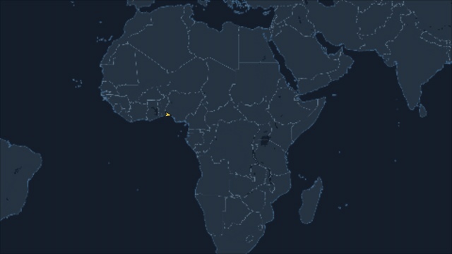
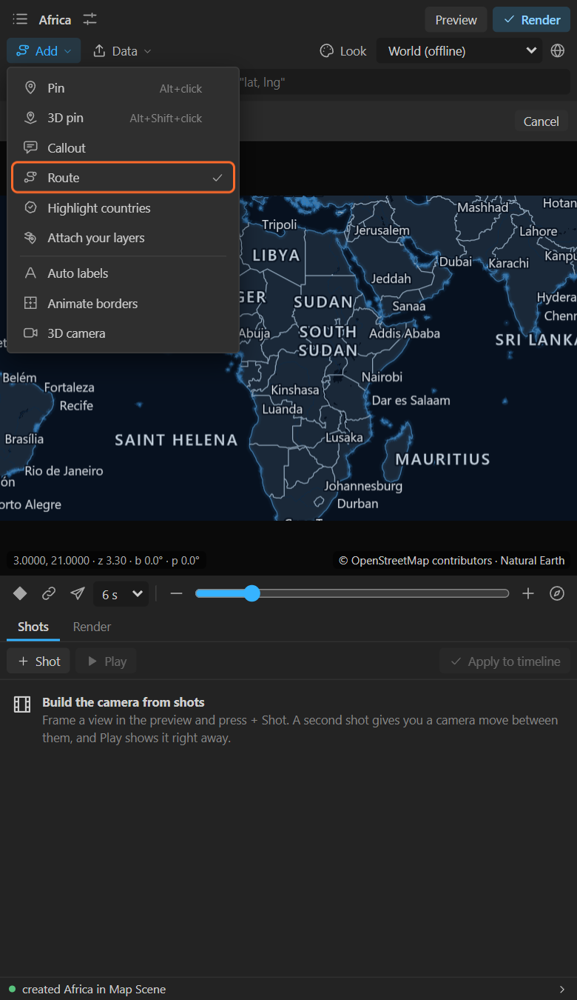
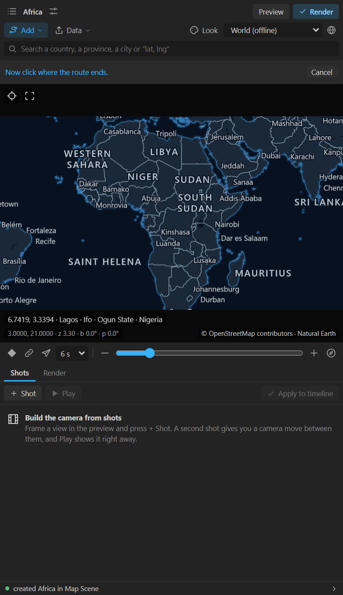
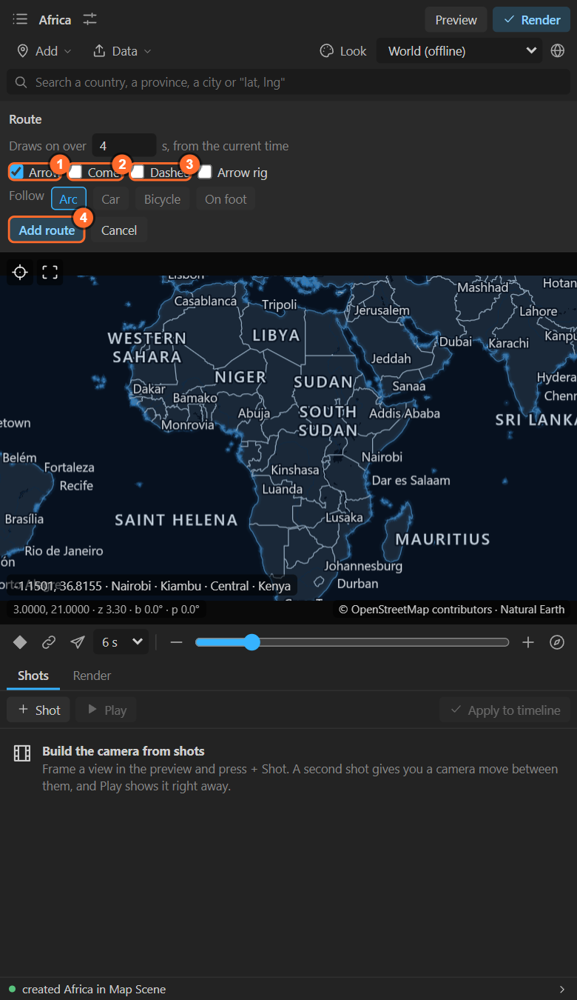
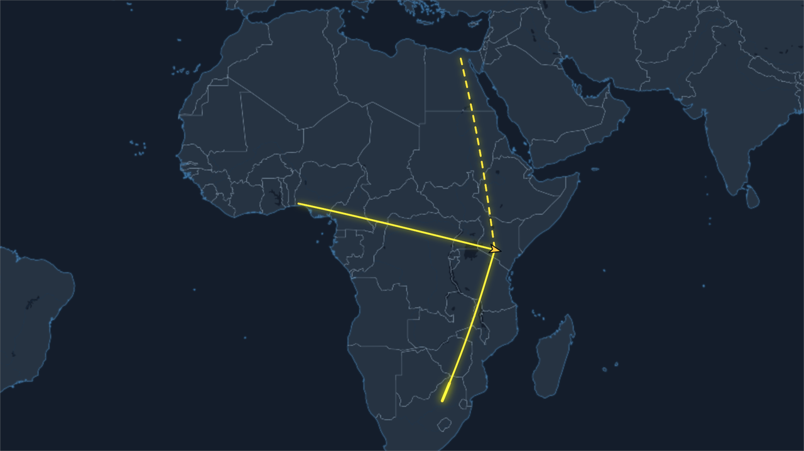

# 12. Routes

A **route** is a line between two places that draws on. It follows the **great circle**, the
shortest way over the Earth, so a long route bends on a flat map the way a flight does. It can carry
an **arrow** that rides it, a bright **comet** head, or **dashes**.

## Draw a route

1. Put the time indicator where the line should start drawing.
2. Click **Add > Route**. The bar says *Click where the route starts*.

   

3. Click the start on the preview. The bar now says *Now click where the route ends*.

   

4. Click the end. The **Route** sheet opens:

   

| Setting | What it does |
|---|---|
| **Draws on over** | Seconds the line takes to draw, from the current time |
| 1. **Arrow** | An arrow travels along the line as it draws and turns with it |
| 2. **Comet** | A bright head runs along the line while it draws, like a comet |
| 3. **Dashed** | Dashes instead of a solid line |
| **Arrow rig** | The line itself becomes an arrow: it tapers from the tail and ends in a head on its tip (see [The arrow rig](#the-arrow-rig)) |
| 4. **Add route** | Makes it. One undo step |

The route is named after its ends: **Lagos to Nairobi**. Arrow, Comet, Dashed and Arrow rig stay as
you left them for the next route.

## The layers it makes

| Layer | What it is |
|---|---|
| **Lagos to Nairobi** | A shape layer: the line, with Trim Paths keyed from 0 to 100 % with an ease. A soft glow when the look has one |
| **Comet: …** | With Comet: the same line, thicker and brighter, trimmed at both ends so only a short head shows, chasing the tip |
| **Traveller: …** | With Arrow: a layer with an arrow, a **Progress** slider (keyed with the line) and **Rotate along Route** |

With **Arrow rig** the route layer is the arrow instead: one shape layer with the line, its head and
every look as a control, described next.

## The arrow rig

An arrow rig is one layer: the line, a **Head** on its tip and a **Tail Head** for arrows with two
ends. The head always sits on the tip, under any camera, on the globe and on terrain, and the line
stops just behind it, so its edges never show past the point. Everything is a control in **Effect
Controls**, so you key it or change it in After Effects without the panel:

| Control | What it does |
|---|---|
| **Progress** | Where the tip is, from 0 to 100 % of the route. Keyed from 0 to 100 like a route's Trim Paths |
| **Tail** | Where the line starts. Key it after Progress and the arrow travels along the route, shorter than the route |
| **Width** | The line's width at the head, in pixels |
| **Tail Width** | The width at the tail, in percent of Width: 100 for an even line, lower for a taper |
| **Taper Length** | How much of the line the taper runs over, in percent |
| **Head Size** | The head in percent: 100 is three and a half times the line's width |
| **Head Style** | Triangle, Chevron (an open V) or None |
| **Both Ends** | A head at the tail too, pointing back |
| **Dash** and **Gap** | Dash and gap lengths in pixels; Dash 0 is a solid line. **Dashed** in the sheet starts it dashed |
| **Dash Speed** | Pixels a second the dashes flow along the line, for a marching-ants look |
| **Outline Width** | An outline in **Outline Color** around the line and the head, for reading over imagery |
| **Color** and **Outline Color** | The arrow's colours, from the map's layer colour |

The camera moves, the GeoJSON export and the style pick-up treat an arrow like any route. Comet and
Arrow (the Traveller) work with it too.

### Your own plane, car or ship on the route

The Traveller is there to carry your artwork:

1. Draw or import your plane. Point it to the **right** (the direction of travel).
2. Parent it to the **Traveller** layer and put it at the Traveller's position.
3. Switch off the Traveller's own **Contents** (the arrow) if you only want your plane.

Retime the journey by moving the **Progress** keys (and the line's Trim Paths keys with them).
**Rotate along Route** off keeps the artwork upright.

## Lines in the air and on the ground

A long route is lifted slightly in the middle, like a flight path, so it reads as an arc on a tilted
map and the globe. With an elevation pack on the map ([chapter 25](25-terrain.md)), the route sits on
the 3D terrain.

## More than two points

The Route tool joins two places. For a route through many places, or a real track:

- **Import** a GPX, KML or GeoJSON line and press **Draw** or **Draw + arrow**
  ([chapter 16](16-import.md)). A GPS track can draw at its **recorded pace**.
- **Draw it** with the Pen tool over the map ([chapter 17](17-your-own-drawing.md)).
- Make several routes end to end, each starting when the last one ends.

## Tips and pitfalls

- **The line is straight, not curved**: two places close together follow a great circle that is
  almost straight. That is correct.
- **The arrow is too small or too large**: scale the Traveller layer. It is sized for the comp's
  height. On an arrow rig, change **Head Size** instead.
- **The line colour**: the map's layer colour (Look > Pins, routes and callouts,
  [chapter 23](23-sky-relief-layer-style.md)), or change the stroke of the route layer.
- **A camera that follows the route**: in the Shots tab, an **Along route** move between two shots
  on the same places ([chapter 9](09-shots.md)).

## Related

- [16. Importing files](16-import.md)
- [17. Your own drawing](17-your-own-drawing.md)
- [32. Flows between places](32-flows.md): many arcs from a table, their width by an amount.
